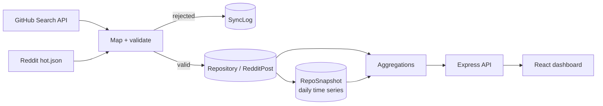

# Open Source Intelligence Dashboard

A MERN app that collects data on popular GitHub repositories and developer discussions on Reddit, stores it in MongoDB, and shows trends on a React dashboard.

The core of the project is a small data pipeline: **ingest → validate → store → snapshot → aggregate → serve**.



## Features

- **Ingestion:** top repos (more than 1k stars) from the GitHub Search API, plus hot posts from 5 programming subreddits. Data refreshes hourly via a cache check; when the cache is stale, the refresh runs in the background so requests aren't blocked.
- **Data quality:** every record is validated before it's written (required fields, valid URLs, numeric ranges, parseable dates). Bad records are skipped, counted, and sampled in a sync log instead of failing the whole batch.
- **Idempotent bulk writes:** each run is a single `bulkWrite` upsert keyed on a natural ID (`fullName` for repos, `postUrl` for Reddit posts). Re-running a sync never creates duplicates.
- **Time series:** one `RepoSnapshot` per repo per UTC day. This powers the "fastest growing" ranking and the per-repo star history chart.
- **Retention:**
  - Snapshots expire after 1 year (TTL index).
  - Sync logs expire after 90 days.
  - Reddit posts older than 30 days are purged, unless bookmarked.
- **Audit trail:** `SyncLog` records the source, status (`success` / `partial` / `failed`), duration, and fetched/upserted/rejected/purged counts for every run.
- **Trending score (0–100):** a weighted mix of log-scaled stars, log-scaled forks, and a recency factor with a 30-day half-life (see [Design notes](#design-notes)).
- **Dashboard:** search and filters, language and subreddit breakdowns, star growth chart, data freshness, bookmarks, and CSV/JSON export.

## Tech stack

React 19 + Vite, Tailwind CSS, Recharts · Node.js, Express, Mongoose · MongoDB · `node:test` for unit tests.

## Project structure

```
client/src/
  components/        UI pieces (GrowthPanel, StatsCards, Filters, RepoCard, ...)
  pages/Dashboard.jsx
  hooks/, context/, services/api.js
server/
  services/          GitHub + Reddit ingestion (fetch, map, validate, bulk upsert, snapshot, log)
  controllers/       request handlers and MongoDB aggregations
  models/            Repository, RedditPost, RepoSnapshot, SyncLog, Favorite
  utils/             trendingScore, queryFilters (safe query building), validators, cacheManager
  tests/             unit tests
```

## Running locally

Prerequisites: Node.js 18+ and MongoDB running locally (or a MongoDB Atlas connection string).

```bash
# backend
cd server
cp .env.example .env        # then fill in GITHUB_TOKEN (optional but recommended)
npm install
npm test                    # unit tests
npm run dev                 # http://localhost:5000

# frontend (new terminal)
cd client
npm install
npm run dev                 # http://localhost:5173
```

Without `GITHUB_TOKEN`, GitHub allows 60 requests per hour; with a token, the limit is 5,000.

## API

| Method | Route | Description |
|---|---|---|
| GET | `/api/github/repositories` | Search, filter, sort, paginate repos (`search`, `language`, `minStars`, `maxStars`, `minForks`, `sort`, `order`, `page`, `limit`≤100) |
| GET | `/api/github/trending` | Top repos by trending score |
| GET | `/api/github/growth?days=7` | Fastest-growing repos by star gain in the window |
| GET | `/api/github/history?fullName=owner/repo&days=30` | Daily star/fork history for one repo |
| GET | `/api/github/export?format=csv` | Export all repos as CSV or JSON |
| GET | `/api/reddit/posts` | Search, filter, paginate Reddit posts |
| GET | `/api/dashboard/analytics` | Totals and chart aggregations |
| GET | `/api/dashboard/insights` | Rule-based summary insights |
| GET | `/api/dashboard/sync-logs` | Recent ingestion runs and data freshness |
| POST/GET | `/api/github/favorites`, `/api/reddit/favorites` | Bookmarks |

## Design notes

**Why the trending score is log-scaled.** An earlier version used `stars*0.5 + forks*0.2 + watchers*0.2 + activity*0.1`. Because raw star counts are in the thousands while activity maxed out at 10 points, the ranking was effectively just "sort by stars". Also, in the GitHub Search API `watchers_count` equals `stargazers_count`, so stars were counted twice. The current version:

1. Puts stars and forks on a log10 scale normalized to 0–1, since popularity is heavy-tailed.
2. Drops watchers.
3. Replaces fixed recency buckets with exponential decay (30-day half-life).

As a result, an actively maintained 20k-star repo can outrank an abandoned 60k-star repo (covered by a unit test).

**Why daily snapshots.** The `Repository` collection only holds current values. Growth questions ("which repos gained the most stars this week?") need history. Snapshots are upserted on `(fullName, day)`, so multiple syncs in a day just update that day's point.

**Safe querying.** All user-supplied search text is regex-escaped and type-checked before reaching MongoDB. This prevents regex injection and `?search[$ne]=` operator injection. Page size is capped at 100. CSV export neutralizes spreadsheet formula injection.

## Limitations / next steps

- Only the top 50 repos (one Search API page) are synced; paging through more would need rate-limit-aware scheduling.
- Reddit is read through public JSON endpoints. Production use should switch to Reddit's OAuth API.
- Syncs are triggered by incoming requests. A scheduled job (cron or a queue worker) would make snapshot timing predictable.
- Bookmarks are global (no user accounts yet).

## Deployment

- **Backend (e.g. Render):**
  - Build command: `npm install`; start command: `node server.js`.
  - Set `MONGODB_URI` (Atlas), `GITHUB_TOKEN`, `CLIENT_URL` and `NODE_ENV=production`.
- **Frontend (e.g. Vercel):**
  - Root directory: `client`; preset: Vite.
  - Set `VITE_API_URL=https://<your-backend>/api`.

## License

MIT
